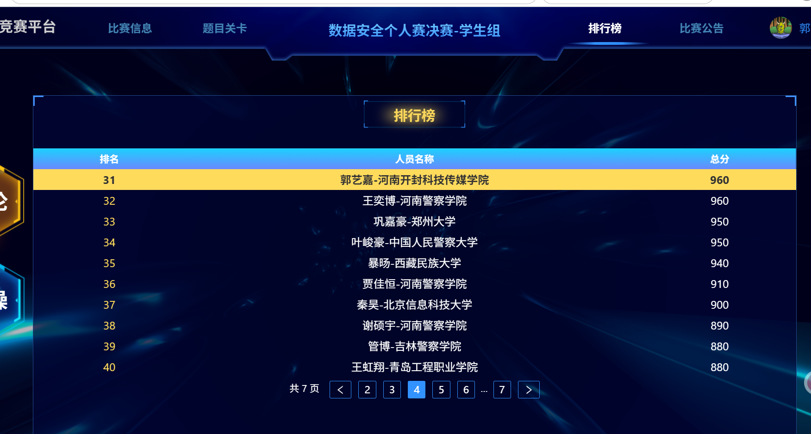
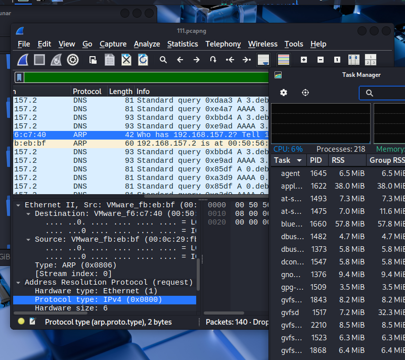
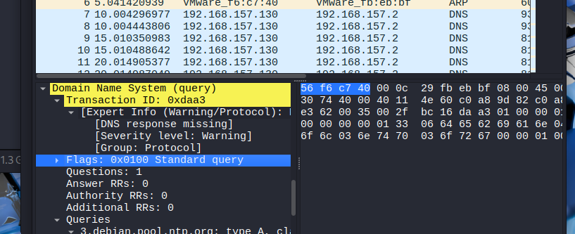
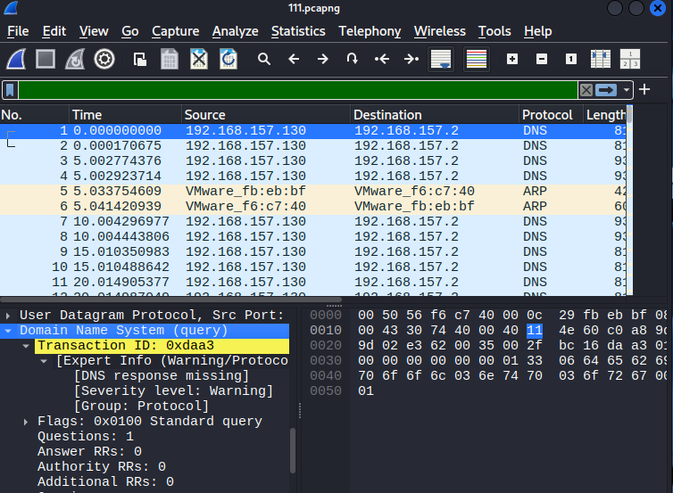
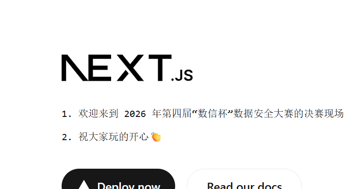
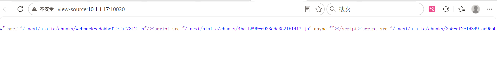
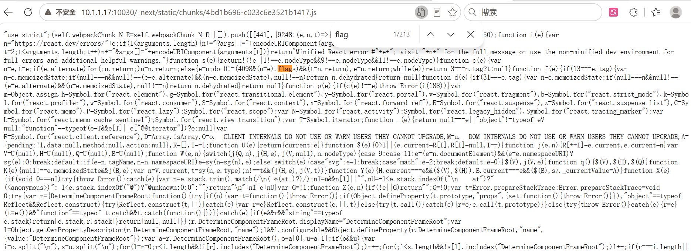
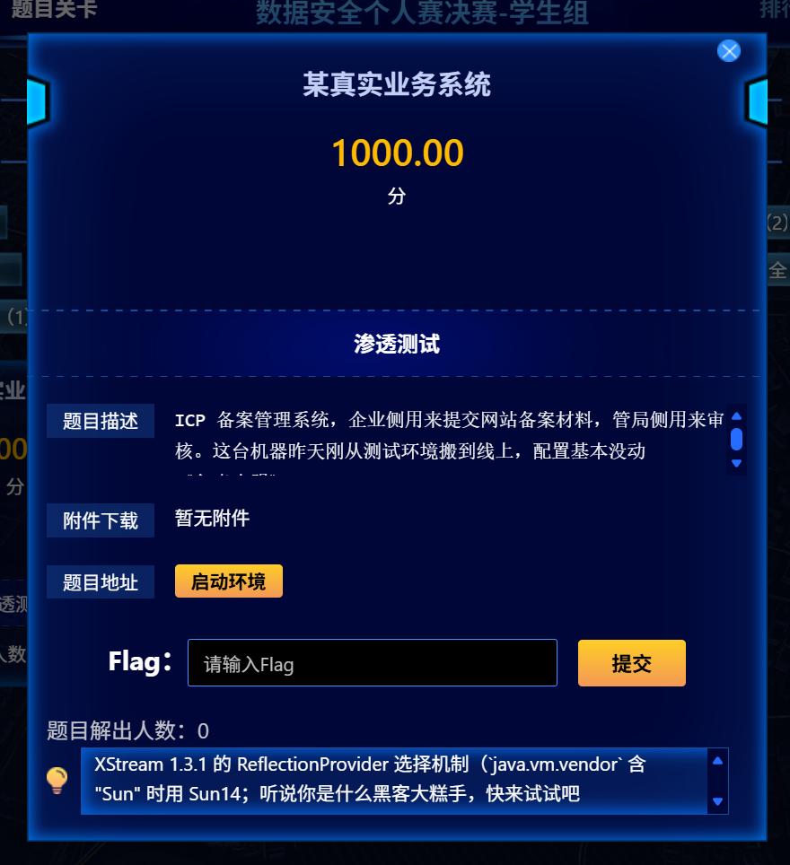

# 2026 数信杯决赛（个人赛-学生组）赛后复盘

比赛时间：2026-11-06
平台：凌虚竞赛平台，实操环境为一组内网服务（10.1.1.x）

赛后复盘，环境已经回收，网上搜不到任何题解，所以实操题部分是"我当时的过程 + 赛后这几天的离线复现结果 + 推测的预期解"。

## 一、IOT CAN 抓包取证（person）—— 赛后唯一完整解出的题

这道题赛后 11-14 号离线复盘时完整做出来了，flag：`flag{c4n_1s_n0t_4_s4f3_bus_7e0_2026}`。

链路：candump 抓包 → 认出 UDS 安全访问流程（`27 03` 请求 seed，`27 04` 发 key）→ 固件是没 strip 的 ELF，从符号表拿到 `calc_key_level3` 和 `decrypt_did` 两个函数 → 还原密钥推导（rol7 + 0xCAFEBABE / 0x12345678 / 0xABCD / 0xDEADBEEF）和 LCG 异或密钥流（state = seed^key^0xC4A4A4C4，state*0x19660D+0x3C6EF35F 取高字节）→ ISO-TP 多帧重组 → 解密 DID 0xD1D2 的 36 字节密文。

详细过程在 `person/wp_IOT_CAN取证.md`，解题脚本 `person/solve.py` 可以一键复现。

当时赛场上没做出来的原因复盘：对 UDS 子功能的方向不熟（奇数请求种子、偶数提交密钥），看到 ECU 固件心里先怵了，且我不会反汇编，其实`-O0 -g` 没 strip 的 x86-64 反汇编非常好读。

## 二、图片隐写题（cha 目录：origin.zip + hj.txt）

题目只给了附件 `origin.png`（zip 里就这一张图，336×336 的抹茶杯扁平插画），环境信息 hj.txt 写着一个 TCP 服务：`10.1.1.18:10103`。

**我当时的进度**：下载了图，用随波逐流扫了一遍，没有扫出有用的东西。借助本地模型写了个脚本将图片上传到开的服务器里
**赛后离线分析（已做完，结论是否定的）**：这几天我把这张图在本地翻了个底朝天，PNG 结构完全干净——chunk 只有 IHDR/IDAT/IEND，CRC 全对，IEND 后无附加数据，zlib 流无多余字节，adler32 校验通过。像素层面也全部排除过一遍：LSB（RGB/BGR/行序/列序/MSB-first 全组合）、bit0~bit3 位平面可视化、RGB/G/B 通道差分、中值残差、频域 FFT（只有桌子条纹和格子背景的正常峰值）、桌面木纹条纹（完美的 9 周期循环）、网格线间距（标准 21px）、稀有颜色分布（贴着边缘，是抗锯齿）——全部没有藏东西。
**我的判断**：这张图本身大概率只是"入场券"，真正的数据在 TCP 服务那一侧（比如连上去按某种协议交互后下发数据，或者图里有什么是和服务端返回内容做对比用的）。也可能是"拿这张图当样本，服务端发的是另一张图，要 diff"。没有环境，这条线到此为止，只能留个记录：**下次见到"附件是一张图 + 一个服务"的组合，第一优先级永远是先连服务，而不是先抠图。**

## 三、流量分析题（111.pcapng）

截图记录了当时的进度：打开 Wireshark，140 个包，看到 192.168.157.130 向网关 .2 发的一堆 DNS A/AAAA 查询（`X.debian.pool.ntp.org`，Debian 系统对时行为），Expert Info 报 "DNS response missing"，以及两帧正常 ARP。

第一张是整体视图，DNS 查询和 ARP 混在一起，下面展开的是 ARP 请求报文的字段详情（who has 192.168.157.2）：

第二张停在一条 DNS 查询上，Transaction ID `0xdaa3` 高亮——这正是赛后复盘第一优先级的提取对象，旁边 Expert Info 的 "DNS response missing" 警告也在这张里：

第三张又看了一遍 ARP 的应答方向（192.168.157.2 is at 00:50:56:...），确认是正常的地址解析：

**我当时的判断**：这些查询是正常的背景流量，黄色警告只是 NAT 网关没回包。
**赛后复盘的方向（没环境了，但这个只需要文件本身，随时能补完）**：全 query 无响应恰恰说明考点大概率藏在请求侧。按性价比排序：

1. `tshark -r 111.pcapng -T fields -e dns.id` 把所有 Transaction ID 抽出来连字节流——截图里恰好停在这条上；
2. 看有没有超长/乱码的查询域名（hex 或 base32 编码的 DNS 外带）；
3. ARP 包的 padding 字段夹带数据；
4. Protocol Hierarchy 确认还有没有别的协议；
5. 兜底 `strings | grep -i flag`。

这份 pcapng 还在比赛的虚拟机里，哪天翻出来发我，这一节我可以直接补成完整题解。

## 四、Web 签到题（rea：Next.js 门户，10.1.1.16:10130）

题目描述：Next.js 搭的门户站点，首页平平无奇，"我们一起签个到"，附件下载显示"暂无附件"。

题目首页长这样，就是 Next.js 脚手架的默认样式加了两行欢迎语：

**我当时的进度**：看了首页，view-source 打开了 `/_next/static/chunks/` 下的 JS 文件（10.1.1.17:10030 也看过源码），在源码里搜 "flag"，命中的都是 React 源码里的 `flags` 变量，没有真 flag。

第一张是页面源码头部，能看到 webpack 和三个 chunk 的引用；第二张是在 chunk 里搜 "flag" 的结果（搜到 1/213 处，命中的是 React 的 error flags）：

**推测的预期解**（Next.js 侦察的标准清单，赛后补课总结）：
- `/_next/static/` 里的 buildManifest / app-buildManifest，看有没有额外的 chunk 没被首页引用；
- source map（chunk 后面加 `.map`），Next.js 生产环境经常漏关，源码里翻 flag；
- `__NEXT_DATA__` 这个 script 标签里的 props，或者 `/api/*` 路由逐个摸；
- `.env`、`/.next/` 目录遍历这类配置残留；
- "签个到"这种描述也可能暗示就是一个纯交互题（比如页面某个按钮请求一个隐藏接口）。
当时的卡点：只在 chunk 里 grep "flag"，侦察面太窄，没看 buildManifest 和 sourcemap，也没有去枚举 API 路由。

## 五、"某真实业务系统"（渗透测试，1000 分，全场比赛 0 解出）

题目描述：ICP 备案管理系统，企业侧提交备案材料，管局侧审核。"这台机器昨天刚从测试环境搬到线上，配置基本没动"。
提示：**XStream 1.3.1 的 ReflectionProvider 选择机制（java.vm.vendor 含 "Sun" 时用 Sun14）**。

题目弹窗的完整截图留下来了：1000 分，渗透测试，"暂无附件"，右下角提示原文是 "XStream 1.3.1 的 ReflectionProvider 选择机制（java.vm.vendor 含 "Sun" 时用 Sun14；听说你是什么黑客大糕手，快来试试吧"

开这道题主要因为下午团队赛是渗透类，所以就把题目弄下来看看会不会和下午有异曲同工之处

**我的判断（赛后补课，未验证）**：这是道 Java 反序列化题。XStream 在 1.4.x 之前根本没有安全框架（黑名单是 1.4.7 之后才逐步加的），1.3.1 意味着提交的 XML 可以实例化任意类。提示里点名 Sun14 ReflectionProvider，基本是在告诉选手"服务端就是默认配置在跑，别在 provider 上纠结，直接打利用链"。结合"备案提交"的业务动作，预期解大概率是：向企业侧的提交接口 POST 一段 XStream 格式的 XML，走经典利用链——动态代理 `EventHandler → ProcessBuilder` 直接执行命令，或者 `JdbcRowSetImpl → JNDI` 外带。"从测试环境搬到线上配置没动"可能还叠加了弱口令/调试端口之类的入口。因为全场 0 解出，没法验证，但提示已经把漏洞组件拍脸上了，当时如果能先打一个 `java.lang.ProcessBuilder` 的探活 XML 看回显，至少能把方向确认下来。卡点：赛场上没认出 XStream 1.3.1 这个版本号意味着什么，看到提示也往"框架机制介绍"方向想了，没有翻译成"没有安全框架 = 任意类可反序列化"。

## 六、经验教训

1. **实操 0 解**：四道实操里，CAN 那道赛后是能做出来的；图片题卡在"本地模型写的脚本一直把图片传不到服务器上；Web 题侦察面太窄；渗透题被提示劝退。共同点是每道题都在正确的门外打转。

   

5. **赛后复盘比赛场上硬磕更有产出**：IOT 那道题完整做出来、写出 wp 和可复现脚本，比考场上一道没解出的体验有价值得多。环境没了，附件在的题都能继续做；但网上搜不到相关题解。
